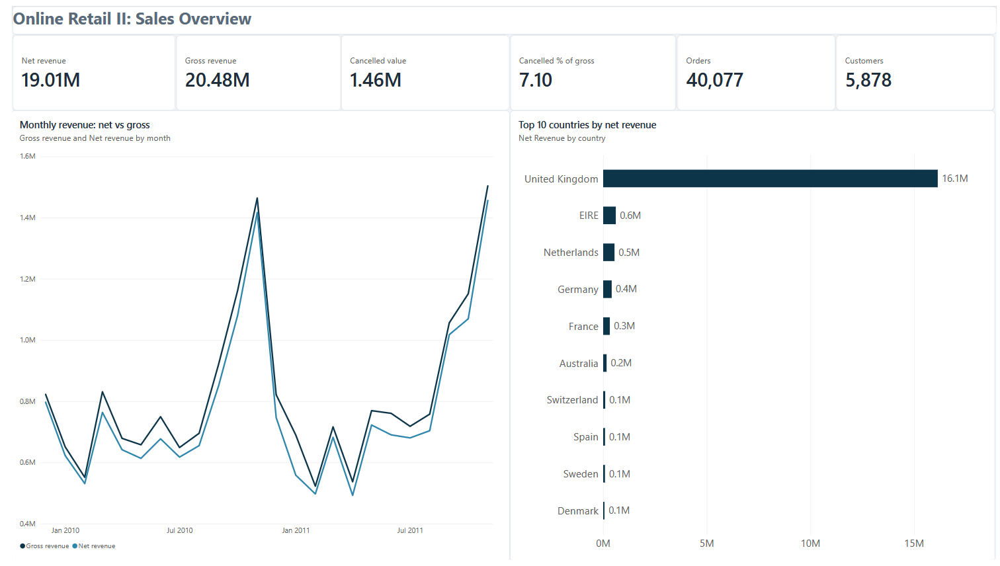
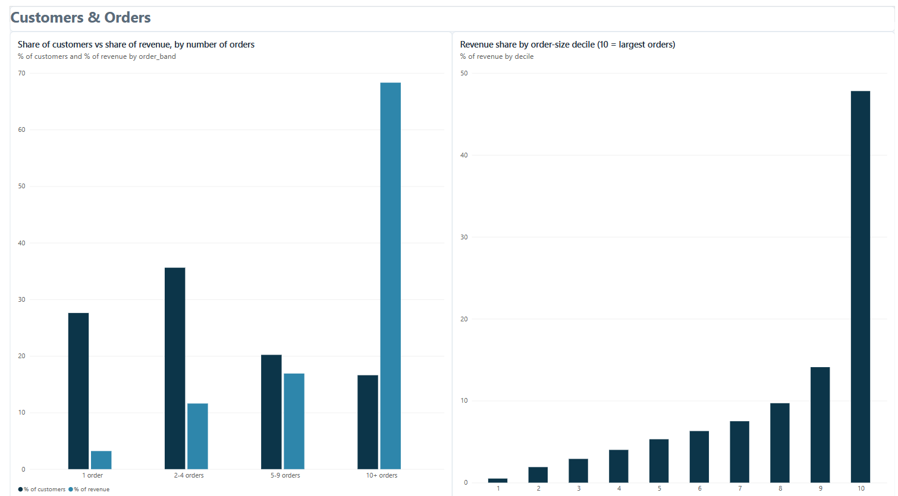
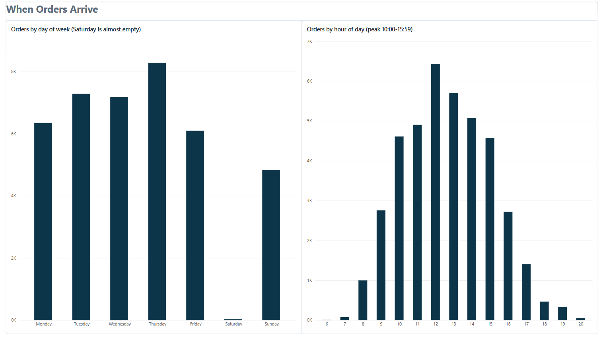

# Online Retail II: Sales, Customer and Order Analysis (SQL + Power BI)

An end-to-end analytics project on two years of transactions from a UK online gift-ware retailer. I cleaned 1.07M raw invoice lines in PostgreSQL, answered ten business questions in SQL, and built a three-page Power BI report for decision makers.

**Headline result:** net revenue was **19.0M** from **40,077 orders** and **5,878 customers**. 16.6% of customers (10+ orders) generate 68.3% of net revenue, and the largest 10% of orders generate 47.8%.

![Sales overview dashboard]
<p align="center">
  
</p>

---

## Table of contents

1. [Business context](#business-context)
2. [Dataset](#dataset)
3. [Tools](#tools)
4. [Approach](#approach)
5. [Data quality findings](#data-quality-findings)
6. [Dashboard](#dashboard)
7. [Business questions and findings](#business-questions-and-findings)
8. [Recommendations](#recommendations)
9. [Limitations](#limitations)
10. [Repository structure](#repository-structure)
11. [How to reproduce](#how-to-reproduce)

---

## Business context

The company sells gift-ware online, and many of its customers are wholesalers. Management wants to know:

- Which products, markets and customers drive revenue?
- How much revenue is lost to cancellations?
- When should stock and staff be planned?
- Does revenue depend on a small group of customers or large orders?

Each analysis is tied to a decision the business could take, not just a chart.

## Dataset

| Item | Detail |
|---|---|
| Source | [UCI Machine Learning Repository: Online Retail II](https://archive.ics.uci.edu/dataset/502/online+retail+ii) |
| License | CC BY 4.0 |
| Period | 1 Dec 2009 to 9 Dec 2011 |
| Size | 1,067,371 raw rows (two sheets of one Excel file) |
| Grain | One row = one product line on one invoice |
| Columns | Invoice, StockCode, Description, Quantity, InvoiceDate, Price, Customer ID, Country |

The dataset has **no product cost**, so the project reports revenue only. It makes no claim about profit or margin.

## Tools

- **PostgreSQL** (pgAdmin): cleaning, modelling and analysis in SQL (CTEs, window functions, `FILTER`, `NTILE`, `PERCENTILE_CONT`)
- **Power BI Desktop**: report built on small aggregated SQL views
- **Git**: version control for the SQL scripts

## Approach

```
raw tables  ->  working copies  ->  typed table  ->  clean view  ->  analysis views  ->  Power BI
(all TEXT)      row_id +            types, trim,     retail_clean    v_* views          3 pages
                line_type           duplicate flag   (used by every
                                                      query)
```

1. **Raw tables are never modified.** Both sheets are loaded as TEXT, so nothing is lost or rejected at load time.
2. **Every row is classified** (`line_type`) so revenue is only computed from the right rows.
3. **Conversions are guarded** with regular expressions and checked afterwards (0 failed conversions).
4. **Duplicates are flagged, not deleted.** The comparison runs across both sheets, because they overlap in December 2010.
5. **One clean view** (`retail_clean`) is the only object the analysis reads from.
6. **Validation queries** reconcile the row counts at each stage (1,067,371 raw rows = 1,067,371 typed rows; 1,033,036 clean rows).

### Row classes

| `line_type` | Meaning | Rows (clean data) |
|---|---|---|
| `sale` | Positive quantity, positive price | 1,007,913 |
| `cancellation` | Invoice starts with `C`, negative quantity | 19,103 |
| `adjustment` | Negative quantity, no `C` prefix (stock write-offs) | 3,393 |
| `zero_price` | Positive quantity at price 0 | 2,621 |
| `accounting_adjustment` | Positive quantity, negative price ("Adjust bad debt") | 5 |
| `manual_entry` | `C` invoice with positive quantity | 1 |

### Revenue definitions

- **Gross revenue** = sum of `line_total` over sales: **20,476,260**
- **Cancelled value** = **1,462,424** (**7.1%** of gross)
- **Net revenue** = sales + cancellations: **19,013,836**

Net revenue is the standard for revenue questions, because some very large orders were placed and cancelled within minutes (see below).

## Data quality findings

| # | Finding | How it was handled |
|---|---|---|
| 1 | 34,335 duplicate rows (3.2%), including rows that appear in both sheets | Flagged with `ROW_NUMBER()` over all business columns and excluded from the clean view |
| 2 | About 20% of rows have no customer ID (guest orders) | Kept in revenue analyses, excluded from customer-level analyses |
| 3 | Product descriptions are not a reliable key: 622 of 4,877 product codes with sales have more than one name | `StockCode` is the product key |
| 4 | Two orders (customers 12346 and 16446, 245,653 together) were placed and cancelled within minutes | Analysis uses net revenue; they are documented as a verification query |
| 5 | 5 accounting rows with a negative price ("Adjust bad debt", 158,676 in total) were first classified as sales | Found when the order-size deciles showed negative orders; reclassified as `accounting_adjustment` |
| 6 | `Unspecified` and `European Community` are not real countries | Left as recorded and noted |
| 7 | December 2011 is incomplete (data ends on 9 December) | Excluded from monthly comparisons |

Finding 5 changed gross revenue from 20.32M to 20.48M. All results were re-run afterwards.

## Dashboard

The Power BI report has three pages. It reads seven small aggregated views (`v_*`), so it loads about a hundred rows instead of one million.

### 1. Sales overview

KPI cards (net and gross revenue, cancelled value and share, orders, customers), monthly net versus gross revenue, and the top 10 countries by net revenue.

![Sales overview]
<p align="center">
  
</p>

- Revenue peaks every autumn (November net revenue: 1.42M in 2010, 1.46M in 2011).
- The gap between the gross and net lines is the revenue lost to cancellations.
- The UK generates 84.9% of net revenue.

### 2. Customers and orders

![Customers and orders]
<p align="center">
  
</p>


- 27.6% of customers bought only once and generate 3.2% of net revenue.
- 16.6% of customers placed 10 or more orders and generate 68.3%.
- The largest 10% of orders generate 47.8% of revenue; the smaller half of orders generates 14.6%.

### 3. When orders arrive

![When orders arrive]
<p align="center">
  
</p>

- Thursday has the most orders (20.7%). Saturday is almost empty (30 orders in two years).
- About 78% of orders arrive between 10:00 and 15:59, with the peak at 12:00.

## Business questions and findings

All queries are in [`sql/online_retail_full_workbook.sql`](https://github.com/tilemaxoschatz-maker/Online-Retail/blob/main/online%20retail.sql), each with the decision it supports, the definition used, the finding and caveats.

| # | Question | Finding |
|---|---|---|
| BQ01 | Which products generate the most net revenue? | Product 22423 leads (314,045), then 85123A (248,338) and 85099B (178,401). 22423 earns about 12.5 per unit against about 2.7 for 85123A, so its lead comes from price, not volume. Using net instead of gross removed two products from the top 20 that only appeared because of cancelled orders. |
| BQ02 | Which products sell high volumes at very low revenue per unit? | 208 of 4,858 products are in the top 10% by volume and the bottom 25% by revenue per unit. Without cost data this says nothing about margin. |
| BQ03 | How does net revenue change through the year? | Net revenue peaks in September to November in both years and falls in December. |
| BQ03b | Does the seasonal pattern repeat? | The top three months (Nov > Oct > Sep) are the same in both years. September to November is 39.5% of January to November net revenue in 2010 and 41.3% in 2011. January to November grew 1.2%, but January to April 2011 was 12.8% below 2010 and May to November was 7.2% above. |
| BQ04 | Which countries generate the revenue, and how large are their orders? | The UK is 84.9% of net revenue. The Netherlands (about 2,405 per order), Australia (about 1,752) and Denmark (about 1,499) place few but very large orders, against about 442 in the UK. |
| BQ05 | Which customers generate the most net revenue? | The top 20 customers generate 3.52M, 18.5% of net revenue. |
| BQ06 | How large are cancellations? | 7.1% of gross sales value. Cancellation rows average about 77 against about 20 for a sale row, so large orders are cancelled disproportionately. |
| BQ07 | Which customers cancel the largest share? | By percentage the top of the list is small accounts, but by value two large accounts stand out: 16029 (28,058 cancelled, 23.8% of its sales) and 12931 (21,048, 22.8%). |
| BQ08 | Do customers come back? | 27.6% bought once (3.2% of net revenue); 16.6% placed 10+ orders (68.3%). |
| BQ09 | On which days do orders arrive? | Thursday peaks (20.7% of orders); Saturday has almost none; Sunday orders are smaller (about 372 per order against about 486 to 564 on weekdays). |
| BQ09b | At which hours? | About 78% of orders arrive between 10:00 and 15:59; peak at 12:00 (16.0%). |
| BQ10 | How is revenue distributed across order sizes? | The largest 10% of orders (above 930) generate 47.8% of revenue; the smaller half generates 14.6%. |

## Recommendations

These follow from the findings above. They are suggestions to be tested, since the data has no cost or customer-type information.

1. **Plan stock and promotions ahead of the autumn peak.** September to November is about 40% of January to November net revenue in both years.
2. **Prioritise retention of repeat customers.** Customers with 10+ orders generate 68.3% of net revenue, while one-time buyers generate 3.2%.
3. **Put attention on very large orders.** The top 10% of orders generate 47.8% of revenue. Check stock availability, credit and dispatch for these orders first.
4. **Review the process for large orders.** Cancellations take 7.1% of gross sales, and the largest losses come from a few large accounts (BQ07). A deposit or approval step for very large orders is worth testing.
5. **Staff for the Tuesday to Thursday, 10:00 to 15:59 window.** Saturday needs no coverage if the pattern holds.
6. **Test a volume discount only as an experiment.** Smaller orders hold under 15% of revenue, and without product cost a discount cannot be judged profitable.

## Limitations

- **No product cost:** revenue only; no profit or margin.
- **Two years of data:** a seasonal pattern repeated twice suggests, but does not prove, a pattern.
- **No customer type:** statements about wholesale customers are hypotheses.
- **Cancellations are not linked to the original invoice**, so cancellation shares are measured on value, and monthly net revenue books a cancellation in the month it occurs.
- **Timestamps** are the time stored on the invoice, not dispatch or delivery time.
- Small countries and customers with few orders have unreliable ratios (for example Singapore: 11 orders).

## Repository structure

```
online-retail-analysis/
├── README.md
├── sql/
│   ├── online_retail_full_workbook.sql   # Part 0: raw tables, Part 1: cleaning, Part 2: BQ01-BQ10
│   └── 03_dashboard_views.sql            # seven aggregated views used by Power BI
├── powerbi/
│   ├── online_retail_report.pbix
│   └── online_retail_report.pdf
└── images/
    ├── 01_sales_overview.png
    ├── 02_customers_and_orders.png
    └── 03_when_orders_arrive.png
```

## How to reproduce

1. Download the dataset from the [UCI repository](https://archive.ics.uci.edu/dataset/502/online+retail+ii) and export each sheet to CSV.
2. In PostgreSQL, run **Part 0** of `online_retail_full_workbook.sql` and import the two CSV files into `raw_retail_2009_2010` and `raw_retail_2010_2011` (header on).
3. Run **Part 1**. The final query returns a one-row summary: 1,067,371 raw rows, 1,067,371 typed rows, 1,033,036 clean rows, 0 failed conversions.
4. Run each query of **Part 2** one at a time.
5. Run `03_dashboard_views.sql`, export the seven views to CSV (or connect Power BI directly to the database) and open the Power BI report.

## Author

[Tilemachos Chatzivasileiou] · [LinkedIn](https://www.linkedin.com/in/tilemachos-chatzivasileiou-1777ba400/) · [GitHub](https://github.com/tilemaxoschatz-maker)

*Data: UCI Machine Learning Repository, Online Retail II, licensed under CC BY 4.0.*
